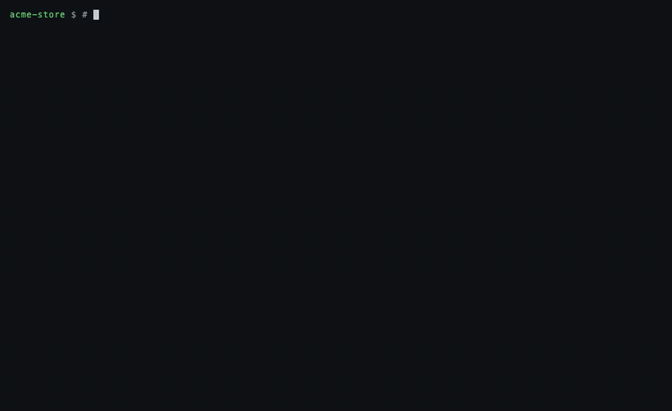

# Rung

**A verification kit for your project, built in one command, and a record of what it has actually
verified.** Rung is a command-line tool for codebases where coding agents write a lot of the code.
`rung init` reads the repo and assembles a kit from the best of each kind of check: the linters and
type checkers you already have, your tests, property tests that must catch planted bugs, scripts
that drive the running app through scenarios and faults with screenshots and video, security gates,
and formal models (TLA+, Lean) for the parts where a missed interleaving is expensive. It installs
skills that make your coding agent use the kit, and records every result in a ledger tied to the
exact bytes it checked. A result expires the moment those bytes change, and a pull request is
blocked only on what it introduces.



<sub>One real session on [`examples/acme-store`](examples/acme-store), a FastAPI and Next.js shop: `rung init`
drafts a feature map you approve, then a drive script and property tests, and `rung check runtime`
reports what the app got wrong, each with what was expected and what it did. The model's drafting
(about 40 minutes in this run) is cut from the recording and labelled where it was cut.</sub>

What a pass means depends on the check: a test suite proves what its tests assert, TLC proves an
invariant over every state of a model, a Lean proof holds for the model it is about. Rung makes
each of those explicit and keeps them current; it cannot make a weak test strong.

```console
$ rung check --changed
Verification checks
  checkout · base 7b34e4ea8821 · 5 selected

PASS  tests (command)
      `pytest -q` exited 0
FAIL  secrets (scan)
      1 new finding(s) at or above `warning`
      NEW error   slack-bot-token  slack.py:1  [7a9fe0a79cbca79f]
FAIL  deps (deps)
      1 missing, 0 younger than 30 days
      MISSING pypi:requests-toolbelt-turbo-pro: not on the registry (hallucinated or private?)
PASS  runtime (evidence)
      3 artifact(s) recorded
FAIL  lease-protocol (tla)
      invariant ResultFromLeaseHolder is violated
      counterexample (5 states):
        2. Claim      owner = w1, valid = TRUE
        3. Expire     valid = FALSE
        4. Claim      owner = w2, valid = TRUE
        5. Complete   result = w1, done = TRUE
```

## Why

Agents write more code than people can read, and "the build passed" says little about whether
a change does what was meant. Rung's answer is three habits.

1. **Evidence over assertion.** A verdict is something a machine checked: a test run, a
   scanner, a recording of the real app, TLC, the Lean kernel. Rung never takes a model's word.
2. **Verdicts expire.** Each verdict stores content hashes of every file it covered. Change one
   byte and it is stale. Nobody has to remember to re-run anything.
3. **Gate on what changed.** On a branch, only problems the branch *introduces* block. Old
   findings are compared with the merge base, or accepted once with `rung baseline`.

## Quick start

Run the first line from a checkout of this repository. It installs the development CLI used
in the examples below. `uv tool install rung-cli` installs the latest published release.

```bash
uv tool install .                 # run from the Rung source checkout
cd your-repo
rung init --dry-run                # inspect commands and file writes
rung init --no-drafts              # record existing checks and install agent guidance
rung doctor --strict               # find missing executables for configured checks
rung check                         # run checks and record verdicts
rung kit                           # see evidence gaps and what to run next
```

To try it on an app with a few bugs planted for it to find, run the same commands in
[`examples/acme-store`](examples/acme-store).

`rung init` in a terminal can also configure a model, show candidate files, and ask which
parts to draft. To opt in unattended, pass `--yes --provider <provider>` or use a provider already
configured in `rung.toml`. `--no-drafts` skips model login and model calls. Add `--no-agents` to
leave agent configuration alone. Use `rung init --refresh --no-drafts` to append newly detected
checks while retaining existing check definitions and comments. Setup adds ignore rules for local
evidence and cache files, so those records stay out of ordinary commits.

Plan a change with `rung plan --path src/payments.py` or inspect a branch with
`rung plan --changed --base origin/main`. The plan offers focused checks for declared targets
and the broader set of checks that may be affected through shared inputs. It also highlights paths
without an execution check. Read each check's assertions to see which behavior it exercises.
Use `rung check --changed --focused` for a quick pass over declared workspace targets; in a
single project it runs the root checks. The output lists which checks it omitted, and when no
declared target matches the change it runs every touched check instead. Use `rung gate` for the merge decision.

Or let your coding agent do the setup. Rung ships a skill that installs the CLI, records your tests
and scans, adds the CI gate and installs the agent rules, while leaving the decisions that are yours
(accepting existing findings, approving laws) to you:

```text
# Claude Code (2.1.275+), inside a session:
/plugin marketplace add CalQuity/rung
/plugin install rung@rung
/rung:setup

# Codex and other agents that read .agents/skills:
mkdir -p ~/.agents/skills/rung-setup && curl -fsSL \
  https://raw.githubusercontent.com/CalQuity/rung/main/plugin/skills/setup/SKILL.md \
  | sed 's/^name: setup$/name: rung-setup/' > ~/.agents/skills/rung-setup/SKILL.md
```

Each drafted part can also be added on its own, for example a script that drives one feature:

```bash
rung draft runtime --intent "create, list and delete a todo through the HTTP API"
```

Runtime and property drafts run their trials in a disposable copy. Generated runtime checks keep
that write guard on replay and copy their evidence back. On Linux, install Bubblewrap and enable
unprivileged namespaces. On macOS, Rung uses sandbox-exec. Rung holds a runtime draft for review
if it still passes after the application sources in the copy are deliberately broken.

## Your project's verification kit

Each part catches what the others miss, and `rung kit` shows them side by side:

| Part | What it catches | Built from |
|---|---|---|
| Linters and type checkers | Mistakes a tool sees without running anything | The ones the project already configures, plus `shortcuts`, which blocks new ways of silencing them |
| Tests | Regressions in the behaviour tests pin down | The project's own suites; `rung prove` shows a bug fix's test catches the bug |
| Property tests | Inputs nobody wrote a test for | Drafted by a model, kept only if they catch planted bugs |
| Security gates | Leaked secrets, vulnerable or invented packages, risky CI | gitleaks, osv-scanner, zizmor, semgrep, `deps` |
| Driving the app | What a user sees, under faults and odd inputs | A drafted script: seeded scenarios in six categories, screenshots, video, traces, an evidence page |
| Formal models | Interleavings and edge cases tests rarely reach | TLA+ for stateful code, Lean for a pure core; they report when the code drifts from the model |
| Agent skills and hook | An agent finishing work its checks do not back | Skills, AGENTS.md rules and a Claude Code Stop hook |

On a small demo shop (a checkout page with a coupon box), `rung init --yes` produced this kit. The drafted
property tests and the Lean model both caught the shop's real bug, a coupon larger than the cart
giving a negative total, and the property tests were left for a person to judge rather than
registered:

```console
$ rung kit
Verification kit

ATTENTION  Linters and type checkers  catches the mistakes a tool can see without running anything
           never run  shortcuts

ATTENTION  Tests  catches regressions in the behaviour the tests pin down
           never run  tests

missing    Property tests  catches inputs nobody thought to write a test for; each must catch planted bugs
           Property tests for shop/pricing.py, kept only if they catch planted bugs
           $ rung draft property shop/pricing.py

ATTENTION  Security gates  catches leaked secrets, vulnerable or invented packages, risky CI
           never run  secrets
           never run  vulnerable-deps
           never run  deps

missing    Driving the app  catches what a user sees, under faults and odd inputs, with the evidence to show it
           Drive the web UI through scenarios and faults, recording screenshots and video
           $ rung draft runtime

ATTENTION  Formal models  catches interleavings and edge cases tests rarely reach, checked exhaustively
           never run  pricing-lean
           never run  pricing-lean-drt

ok         Agent skills and hook  catches an agent finishing work its checks do not back
           installed  rung skills + AGENTS.md
           installed  verify-pricing-lean  project-specific verification skill
           installed  Stop hook  blocks an agent finishing with stale checks

Laws (LAWS.md): 4 proposed

Next: rung check  7 check(s) stale or never run: shortcuts, tests, secrets, vulnerable-deps ...
```

`rung kit` always ends with the one command to run next: a failing check first, then a formal model
whose code changed, then stale checks, then the missing parts and the laws waiting for approval.

## What it checks

| Concern | Check | What blocks |
|---|---|---|
| Tests | `command` | The suite fails |
| Bug fixes | `rung prove` | The new test passes *without* the fix, so it proves nothing |
| Shortcuts to green | `shortcuts` | A change adds `@ts-ignore`, `# type: ignore`, `as any`, a lint disable, a skipped, focused or deleted test, a lowered coverage threshold or a relaxed type-checker setting |
| Type checking and lint | `command` | The project's own `tsc`, pyright, mypy, ruff, ESLint, `go vet` or Clippy fails (`rung init` records the ones it finds configured) |
| Laws on real code | `rung draft property` | A Hypothesis or fast-check property fails, or the properties catch fewer than half the deliberate bugs Rung plants |
| Real behaviour (UI, API, CLI) | `evidence` | The drive script fails or records no evidence; `require = [".webm"]` demands a video. Without a script, an agent's browser or computer-use recording, attested with `rung attest`, holds until the code changes |
| Secrets | `scan` (gitleaks) | A new secret appears |
| Vulnerable dependencies | `scan` (osv-scanner) | A new known vulnerability appears |
| Invented or brand-new packages | `deps` | A new package is missing from PyPI/npm, or is under 30 days old |
| CI workflows | `scan` (zizmor) | A new insecure pattern appears in a workflow |
| Code patterns | `scan` (semgrep, opengrep, trivy, any SARIF tool) | A new finding at or above `fail_on` |
| Concurrency and protocols | `tla` | TLC finds an interleaving that breaks an invariant |
| Core logic | `lean` + `drt` | A proof fails or cheats, or the code disagrees with the proven model |

See [docs/RECIPES.md](https://github.com/CalQuity/rung/blob/main/docs/RECIPES.md) for APIs, web apps, libraries, job queues and monorepos.

## Laws

`LAWS.md` lists what must never break, one sentence each, and the checks that enforce it:

```markdown
## refund-bounded
A refund never exceeds the original charge, even under concurrent retries.
- enforced by: refund-protocol, refund-model, tests
- status: approved
```

`rung laws` shows whether each law currently **holds**: approved, enforced, and every enforcing
verdict fresh. Agents may propose laws; only people approve them.

## Driving the app

Driving the app starts with a **feature map** you approve. `rung map` has the model read the code
(routes, templates, commands, docs) and write `.rung/verify/features/`: an index with how to launch
the app for verification, the driving conventions and the proof rules, and one file per user-facing
feature with its sub-features (each with a short ID), every way a user reaches it, the driving
recipe (preconditions, then each action paired with its observable result) and the gotchas. Rung
checks every file against that shape and sends a map that breaks it back to the model.

You then decide feature by feature: approve it, mark it **not built yet** (a disabled button, a
stubbed route: never driven), or drop it. `rung map` shows the map in the terminal and writes
`.rung/verify/features/index.html`, one page with a card per feature; once a script has run, each
sub-feature on it shows its latest result (proven, failed, unreachable and why) and its screenshots.

```console
$ rung map --approve coupons --not-built pay
$ rung draft runtime --require .png
```

`rung draft runtime` then writes a script for the approved features only, registered as a check
once it has worked against the real app:

- **`.rung/verify/drive.py`**, a script that starts the app on a free port, drives the approved
  features the way a user does (Playwright for web UIs, HTTP or CLI calls otherwise) and asserts on
  what a user would see. Each scenario is named after the sub-feature ID it proves, and every approved
  sub-feature must have one, or be reported as unreachable with the precondition the run lacked. It
  never calls internal functions or test-only endpoints. The model is shown the routes the app really
  serves, found in its code (FastAPI, Starlette and Flask decorators, Express, Hono and Koa handlers,
  Next.js app and pages routers), and drives only those.
- **A map that cannot drift silently.** Approval pins a digest of each feature's file and the code it
  comes from. When either changes, `rung kit` and `rung draft runtime` say so, and `rung map
  --redraft` refreshes the map: unchanged features keep their approval, changed ones wait for yours
  again, and a "not built yet" or "drop" outlives the refresh.
- **A project verification skill** (`.claude/skills/verify-<project>/`) that tells the project's
  coding agents to drive the app after any user-facing change, refresh the feature map when they add
  a feature, and treat a failure as a product bug rather than weaken the script.
- **Scenarios, not just the happy path.** For each feature the script drives named scenarios in six
  categories: `happy`, `input` (empty, very long, unicode, case and spacing variants, boundary values,
  invalid formats, injection-looking strings), `state` (repeats, empty carts, stale state, refresh
  after success, deep links), `auth` (signed out, wrong user, bad token), `fault` and `robustness`
  (keyboard only, no console errors or uncaught exceptions, no 5xx). A category that does not apply
  needs a stated reason, and Rung rejects a script that drives only the happy path. A scenario the
  real app fails while drafting is a finding for you, never sent back to the model to make it pass.
- **Seeds that reproduce a failure exactly.** Rung passes `RUNG_SEED` and the script derives every
  choice from it: which inputs to try, which backend call to delay and for how long, when to reload.
  `runs = 3` runs seeds `seed`, `seed+1`, `seed+2`, each in its own directory; a failure names its
  seed and prints `rung check runtime --seed N`, which runs that seed again. While drafting, Rung runs
  the same seed twice and sends the script back if the outcomes differ.
- **Fault scenarios.** `RUNG_FAULTS` names the adverse conditions to drive: slow or failing backend
  calls and going offline (Playwright `context.route`, `set_offline`), double submits, reload or back
  mid-flow, killing and restarting the app on the same data, a fake clock for expiry, a dependency on
  a dead port. Under each, the script asserts that nothing happened twice, no state was lost, and the
  user saw an error message rather than a stack trace.
- **Recordings you can replay and share.** Every run writes its evidence to a fresh directory: a
  video (`--require .webm`), a Playwright trace (`--require .zip`; open it with
  `npx playwright show-trace trace.zip` or at trace.playwright.dev), a HAR network log (`.har`),
  screenshots named after the step they prove, a transcript and a structured `result.json`. Their
  hashes go into the verdict, which stays valid only while the code it covers is unchanged. Each run
  also gets an `index.html` evidence page (`rung evidence runtime` rewrites it): the result, each
  scenario's faults and assertions (expected against observed), its screenshots in step order, the
  video, links to the trace and HAR, and the command that reproduces a failure. It is one file with
  relative links and no network access, so it opens from a laptop or a CI artifact download alike.

Where a script cannot reach a feature (a login flow, a native app), an agent can drive it with its
own browser or computer-use tool and record it with `rung attest <check> <files> --by <tool>`. Such
evidence is recorded with who captured it and is never re-run, so it is weaker than a script.

## Property tests that are tested themselves

`rung draft property pricing.py --intent "a total is never negative and equals the discounted sum"`
has the model write Hypothesis (Python) or fast-check (TypeScript) properties for the laws, then:

- runs them on the real code. A property that fails is a finding for you, never sent back to the
  model to make it pass. So is any failure Rung cannot pin on the test's own code;
- breaks the code on purpose, one token at a time (`<` to `<=`, `+` to `-`, `and` to `or`), and
  runs them again. Only a property failure counts as catching a bug; one that breaks the build or
  times out is not counted. Properties that catch fewer than half go back to the model with the
  bugs they missed. If no bug can be planted at all, the result says INCONCLUSIVE.

All of this runs in a disposable copy of the project, without credential-looking environment
variables, so your files are never mutated. That limits accidents; it is not a security sandbox,
so read a drafted test before trusting it. The accepted test is written at the end (never over an
existing file); a failed draft is kept in `.rung/cache/drafts/`. The result is a `command` check
covering the project, and proposed laws in `LAWS.md`.

## Formal methods where they pay

TLA+ and Lean are not for every file. Rung recommends them where the survey finds code that
needs them, and the model drafts the first version.

- **`rung draft tla queue.py`** writes a TLA+ model whose actions copy the code's real guards,
  then runs TLC. A counterexample stops the draft and goes to you. The model never gets to
  edit the spec until the checker is quiet. When the code calls database functions
  (`supabase.rpc("claim_job")`, `select claim_job(...)` in SQL strings), Rung adds the `*.sql`
  files that define them to the prompt, oldest definition first, and covers them with the check;
  a call whose definition it cannot find is a warning, because the model then has to assume the
  call is atomic.
- **`rung draft lean pricing.py`** writes a small Lean model of the intended behaviour, proves
  its laws, and sets up a differential test that holds the real code to it on random inputs.
  Lean checks pass only when `#print axioms` shows no `sorry`, no `native_decide` and no
  invented axioms. It is shown the same SQL definitions.

These are the formal-methods part of the project's verification kit, and Rung keeps them honest
after the draft:

- **Models cannot silently go stale.** Each `tla` and `lean` check records the commit and a digest
  of the code its model was last confirmed to describe (`.rung/formal/<check>.json`). When that code
  changes, `rung check` does not rerun TLC on the old spec and call it a pass: it reports that the
  code changed since the model was confirmed, names the files, and the laws it enforces show as
  UNPROVEN. `rung maintain <check>` shows the model the diff and commit messages, has it classify
  each change (no effect, the model must change, the promise changed on purpose with cited
  evidence, or the promise may be broken), updates the model from the code, and rechecks it:
  **in sync**, **updated**, **bug** or **blocked**. An invariant or theorem is never weakened
  without cited evidence. `rung confirm <check> --by NAME --reason TEXT` records a person's review.
- **Shown able to fail.** After a TLA+ spec passes, Rung removes one action guard at a time and
  runs TLC on each mutant; at least one must break an invariant, or the invariants are too weak to
  catch anything and the spec goes back to the model. The score is shown with every check.
- **Readable.** A counterexample reads as numbered steps in plain words ("a customer clicks
  Pay"), with the invariant it breaks and the harm, next to the raw trace, and is drawn as a
  Mermaid state diagram. Each check shows its scope: the bounds, the assumptions and what it does
  not cover. Laws carry a `harm:` line.
- **A skill per model.** `.claude/skills/verify-<check>/SKILL.md` tells an agent what the model
  promises, the files and functions it covers, its bounds, how to replay a counterexample against
  the code, when to run `rung maintain`, and the confirmed commit.

```console
$ rung check payments-tla
ERROR payments-tla (tla): the code changed since the model was confirmed at 29b079f; the model may no longer describe it
      changed: shop/payments.py
      next: rung maintain payments-tla
$ rung maintain payments-tla
UPDATED payments-tla: the model was updated to describe the code (spec/tla/payments/Checkout.tla) and it checks
  [model-must-change] shop/payments.py:12-16 checkout now holds a per-order lock across the check, charge and mark paid
  fail-ability: 4/5 guard mutants caught by an invariant
```

Every drafted file (spec, adapter, drive script, property test) is sent back to the model if it
hard-codes a home or temporary directory path (`/Users/<name>/`, `/home/<name>/`, `C:\Users\`,
`/tmp`), because it would run on one machine only.

[`examples/lease-queue`](https://github.com/CalQuity/rung/tree/main/examples/lease-queue) shows both catching a real bug, plus a
three-step case only the differential test finds.

## In CI

The example pins the current release tag. To use the development gate behavior below,
pin a reviewed commit that includes it.

```yaml
on:
  pull_request:
    types: [opened, synchronize, reopened, labeled, unlabeled]
permissions:
  contents: read
  pull-requests: read
jobs:
  rung:
    runs-on: ubuntu-latest
    steps:
      - uses: actions/checkout@v7
        with:
          fetch-depth: 0
          persist-credentials: false
      - uses: CalQuity/rung@v0.3.0
        with:
          upload-evidence: false   # v0.3.0 uploads evidence by default
          comment: false           # v0.3.0 comments by default, which needs pull-requests: write
          policy-changes: fail     # v0.3.0 only warns by default
```

Use `rung gate --base origin/main` to run the same merge decision locally or in another CI
provider. The gate compares scans with the merge base and re-runs the declared checks, including
the checks that enforce approved laws. Local verdicts and manual captures are receipts for review.
A merge gate requires repeatable checks.

The action runs the gate with policy preflight enabled. Changes to `rung.toml`, `LAWS.md`,
waivers, baselines, generated drive files, formal models, declared `specs`, or GitHub workflow files block
before checks execute. Use `policy-paths` for other rule files and trusted wrappers.
The gate follows static Python scripts and modules through `uv run`, including launchers named
by package scripts. It protects repository symlinks along those paths and their repository-local
targets. List files used by dynamic wrappers in `policy-paths`.
When a custom command claims a changed path through `verifies` or required coverage,
the gate also requires a policy declaration. Include every verifier script and helper in
`specs`, or list the check's launch script in `policy_paths`. A policy path exempts only the
checks whose launch files it matches.

The gate reads its own settings from the `[gate]` table of `rung.toml` on the merge base, so a pull
request cannot loosen the gate that judges it. The action's `policy-changes`, `policy-paths` and
`require-coverage` inputs (and the matching `rung gate` options) apply only to keys the base leaves
unset. Paths are relative to the directory holding `rung.toml`. A pull request that edits the
`[gate]` table always needs approval.

```toml
[gate]
policy_changes = "fail"            # or "warn" to report policy changes without blocking
policy_paths = [".semgrep/rules/**"]
require_coverage = ["src/**"]
approval_label = "rung-policy-approved"   # the default
```

To approve a reviewed policy change, a maintainer applies the approval label. The action honors it
only on the run that applying the label starts, and checks through the API that the label is still
there, so a later push needs a fresh approval: remove the label and apply it again. Policy changes
are then reported but do not block, and the checks still run. This covers Dependabot updates to
workflow files too. Anyone with triage access can apply labels, so limit those roles to maintainers.
Locally, `rung gate --pr-label rung-policy-approved` has the same effect.

```bash
rung add command refund --run 'python3 verify_refund.py' \
  --verifies 'app/**' --specs verify_refund.py 'verification/**'
```

For Node checks the gate also protects `package.json` script definitions, package-manager
selection, and directly invoked scripts. Use `--require-coverage 'src/**'` (or the Action's `require-coverage` input) to fail
when a changed file in that scope has no matching declared target. Set `verifies` to declare
the paths a check is intended to verify. Explicit `covers` globs also count. The default
repo-wide freshness scope alone does not satisfy required coverage.

The gate also checks that it is judging the pull request. When the event has a pull request, HEAD
must be its head commit or a merge commit of it; otherwise the gate blocks. A `pull_request_target`
workflow that checks out the default ref (the base) fails this way. Set `pr-head: ""` only when the
action runs on a different repository, as Rung's own fixture job does.

Run the workflow on a disposable runner with read-only permissions and without repository secrets.
Pin the action by commit SHA in a required workflow that contributors cannot replace. Enable
`upload-evidence: true` only for runs using test accounts and synthetic data. Videos, HARs, traces,
and screenshots may contain the data shown to the browser. The report goes to the job summary.

The step that runs the checks also decides the result: it exits with the gate's code. The local
executor protects against accidental or agent-made weakening of checks, not against a hostile pull
request. Pull request code runs as the runner user, so it can alter the runner, later steps, the
installed Rung, and the report. Steps that run after it, including `comment: true`, publish a
result they cannot vouch for. Do not give that job a write token. To post a sticky comment, use a
separate `workflow_run` workflow that never checks out or runs pull request code:

```yaml
# .github/workflows/rung-comment.yml
on:
  workflow_run:
    workflows: [rung]
    types: [completed]
permissions:
  pull-requests: write
jobs:
  comment:
    if: github.event.workflow_run.event == 'pull_request'
    runs-on: ubuntu-latest
    steps:
      - env:
          GH_TOKEN: ${{ github.token }}
          REPO: ${{ github.repository }}
          RUN: ${{ github.event.workflow_run.id }}
          SHA: ${{ github.event.workflow_run.head_sha }}
          CONCLUSION: ${{ github.event.workflow_run.conclusion }}
        run: |
          # Fork pull requests are not listed on the run itself; find the PR by its head commit.
          pr=$(gh pr list --repo "$REPO" --state open --search "$SHA" --json number --jq '.[0].number')
          [ -n "$pr" ] || exit 0
          printf '<!-- rung-report -->\nRung gate: **%s**. [Run details](https://github.com/%s/actions/runs/%s)\n' \
            "$CONCLUSION" "$REPO" "$RUN" > report.md
          existing=$(gh api "repos/$REPO/issues/$pr/comments" --paginate --jq '.[]
            | select(.user.login == "github-actions[bot]" and (.body | startswith("<!-- rung-report -->"))) | .id' | head -n 1)
          if [ -n "$existing" ]; then
            gh api -X PATCH "repos/$REPO/issues/comments/$existing" -F body=@report.md > /dev/null
          else
            gh pr comment "$pr" --repo "$REPO" --body-file report.md
          fi
```

The conclusion comes from GitHub, not from files the pull request could write. Treat any text you
copy from the gated run's summary or artifacts as output from code under review.

On Linux runners the action installs Bubblewrap, which drafted and `isolate = true` evidence checks
use. Ubuntu 23.10 and later can block unprivileged user namespaces through AppArmor. On
GitHub-hosted runners, which are single-use VMs, the action lifts that restriction for the job. On a
self-hosted runner, run `sudo sysctl -w kernel.apparmor_restrict_unprivileged_userns=0` (or install an
AppArmor profile for `bwrap`) if you accept that change on that machine; otherwise isolated checks
report an error.

### Run PR checks in Daytona

For repositories that want to keep test execution off the GitHub runner, a trusted PR workflow can
choose `executor: daytona`. Create a private, versioned Daytona snapshot with Git, Rung built from
the same commit as the pinned action, and your project's offline toolchain and dependencies. Keep the
snapshot credential-free. Set `DAYTONA_API_KEY` as a secret in the repository that uses Rung.

```yaml
# In the adopting repository's trusted PR workflow, after a full checkout.
- uses: CalQuity/rung@<reviewed-commit-sha>
  with:
    executor: daytona
    daytona-snapshot: my-project-verify-v1
  env:
    DAYTONA_API_KEY: ${{ secrets.DAYTONA_API_KEY }}
```

Use a clean checkout with `fetch-depth: 0` and `persist-credentials: false`. The coordinator
transfers a Git bundle containing the commit and its reachable history, up to 100 MiB. Confirm that
your repository can share that history with Daytona before enabling this. The sandbox has outbound
network access blocked and expires after 26 minutes, longer than every stage limit combined.
Rung requests deletion at the end of the run; if that request fails, Rung prints a warning and
keeps the verified result. The job summary contains check verdicts, short summaries, and the
resolved snapshot ID, so you can tell which image ran the checks even if the name is moved later.
Screenshots and other evidence files stay in the sandbox and expire with it. A provider or snapshot
error fails the gate.
Use offline tooling for checks that normally query a registry or scanner service, or run those
checks in a separate required job.

Daytona keeps secrets on the coordinator away from pull request code. It does not make the result
tamper-proof: as with the local executor, the receipt is produced in the sandbox where pull request
code runs, so a hostile pull request can forge its own verdicts. Treat Daytona as confidentiality
for secrets, not as integrity against the code under review.

Keep the workflow, action pin, snapshot and secret under maintainer control. Run repository
commands and dependency installation inside the sandbox. Ordinary fork PR workflows do not receive
the secret. Use the standard read-only runner for that workflow, or arrange a separate
maintainer-controlled run that pins the reviewed commit. See
[GitHub's guidance on privileged pull request workflows](https://docs.github.com/en/actions/reference/security/securely-using-pull_request_target).

To invoke the backend from another CI provider, install the optional SDK in Rung's tool environment
with `uv tool install . --with daytona==0.227.3`, set `DAYTONA_API_KEY` on the coordinator, and run
`rung gate --base origin/main --executor daytona --daytona-snapshot my-project-verify-v1`.

To run the same check before every push, add Rung to `.pre-commit-config.yaml`:

```yaml
- repo: https://github.com/CalQuity/rung
  rev: v0.3.0
  hooks:
    - id: rung-check
```

## With coding agents

`rung agents` installs CLI workflows in `.claude/skills/` and `.agents/skills/` and adds a
managed section to `AGENTS.md`. Ask Claude Code or Codex to run the Rung skill in the project.
The skill walks through setup preview, change planning, checks, replay, and reporting using
the same CLI you run in a terminal.

```bash
rung plan --changed --base origin/main --json
rung check --changed --base origin/main --json
rung report --json
```

`rung agents --hooks` installs the Claude Code Stop hook. For Codex, use
`rung agents --codex-hooks` and review the project hook with `/hooks` in Codex.
Both hooks point the agent to checks that still need to run and allow the second stop
so a tool failure cannot trap the session; the Codex hook keeps a per-session marker in
`.rung/cache/hooks/` for this when Codex does not report that it already blocked once. In a
workspace, the hooks ask first for the checks whose `verifies` targets hold the edited files
(and checks with no declared target); checks for other packages are left to
`rung check --changed` and the merge gate. An edit to shared code outside every declared target
asks for every touched check. The merge workflow uses `rung gate` to execute
the checks independently. See [Codex hook setup and trust](https://learn.chatgpt.com/docs/hooks).

Drafting uses a model you already have. `rung init` reuses your `claude` or `codex` login, or
any OpenAI-compatible endpoint, including local models. Rung never stores credentials.

## Commands

| Command | Does |
|---|---|
| `rung init [--dry-run] [--refresh] [--no-drafts] [--no-agents]` | Build the verification kit: survey the repo, add checks, install agent skills and the Stop hook, draft app scenarios, property tests and formal models with your approval |
| `rung kit` | Every part of the kit, its checks and their state, and the next command to run |
| `rung map [--approve F] [--not-built F] [--drop F] [--redraft]` | Draft the feature map, show it (terminal and HTML page), record your decision on each feature |
| `rung plan [--path PATH\|--changed]` | Recommend checks and show scopes for a proposed or actual change. `--path` takes files or directories, relative to the current directory |
| `rung check [ids] [--changed [--focused]] [--base REF]` | Run checks and record verdicts. `--focused` runs the checks whose declared targets (or the root project) hold the change, and falls back to every touched check when none do |
| `rung check --reuse-local` | Skip checks with a fresh local verdict from the same base and environment (`--ci` is an alias kept for compatibility; CI should use `rung gate`) |
| `rung check <id> --seed N [--scenario NAME]` | Run one seed (or scenario) of a drive script again, without recording it |
| `rung evidence <check> [--seed N] [--out DIR]` | Write the HTML evidence page of a drive script's newest run |
| `rung gate [--base REF] [--executor local\|daytona]` | Re-run the merge checks after policy preflight |
| `rung status [--require-fresh]` | Fresh, stale, failing; `--require-fresh` (alias `--ci`) exits 1 unless all fresh |
| `rung report [--format md\|json]` | Checks, laws, new findings and fix proofs |
| `rung prove 'pytest tests/test_x.py'` | Show a test fails without the fix and passes with it. Pytest and Node can report individual cases. |
| `rung laws [--approve ID]` | Which laws hold |
| `rung add <kind> <id> ...` | Declare a `command`, `evidence`, `scan` or `deps` check |
| `rung attest <check> <files> --by <tool>` | Record evidence an agent or person captured (Claude in Chrome, Codex, computer use) |
| `rung baseline <check>` | Accept a scan's existing findings |
| `rung waive <check> <fingerprint> --reason ...` | Accept one finding until an expiry date |
| `rung draft tla\|lean\|property\|runtime` | Model-drafted spec, proof, property tests or drive script; a checker decides |
| `rung maintain <check>` | Bring a TLA+ or Lean model back in line with code that changed since it was confirmed |
| `rung confirm <check> --by NAME --reason TEXT` | Record that a person checked a TLA+ or Lean model still describes the code |
| `rung agents [--hooks] [--codex-hooks]` | Agent workflows, AGENTS.md rules, optional Stop hooks |
| `rung doctor [--strict]` | Diagnose missing executables for the current kit; `--json` lists `tools` and the `strict_failures` that `--strict` fails on |
| `rung ledger [--prune]` | Check the verdict files for corruption |

Every command accepts `-C DIR` and `--json`. Human output uses color in a terminal. Use
`--no-color` or set `NO_COLOR` for plain text. Exit codes are `0` for success, `1` for a failed
check or gate, `2` for configuration or usage errors, `3` for a missing required tool, and
`4` for a Git error. A missing dependency of an individual check is reported as a check error
and exits `1`; `3` applies when the command itself cannot start without a prerequisite.

Configuration lives in `rung.toml`; see [docs/CONFIG.md](https://github.com/CalQuity/rung/blob/main/docs/CONFIG.md).

## How Rung stays honest

- A checker never reports `pass` unless its tool confirmed the result. Missing tools and
  malformed output are errors, and so is a TLA+ spec that reaches only one state, or one whose
  invariants notice no action guard being removed.
- A TLA+ or Lean model whose code changed since it was confirmed is an error, not a rerun.
- A file that changes while a check runs voids the verdict.
- The ways an agent can get to green without fixing anything (silencing the type checker or linter,
  skipping or deleting tests, lowering coverage thresholds) block in the `shortcuts` check.
- Gitleaks always runs with `--redact`, and secret-looking values (tokens, keys, credentials in
  URLs) are masked before command output is stored in the ledger. That masking is best effort:
  commands should not print secrets.
- Waivers need a reason, an approver and an expiry date. Expired waivers stop applying.
- Each verdict file carries a hash of its own contents, so a hand-edited, truncated or conflicted
  file reads as "re-run this check". That is an integrity aid, not a signature: whoever can write
  the file can rehash it, so CI re-runs what a change touches (`rung check --changed`) and changes
  to `.rung/` and `LAWS.md` deserve review like any other change (CODEOWNERS helps).
- Approving a law or adding a waiver is a file edit, not an authenticated signature.
- Rung collects no telemetry.

Rung's own repository is checked by Rung: see [`rung.toml`](https://github.com/CalQuity/rung/blob/main/rung.toml) and [`LAWS.md`](https://github.com/CalQuity/rung/blob/main/LAWS.md).

## Requirements

- **Python 3.11+** and **git**.
- **The tools for the checks you enable.** Java 11+ and
  [`tla2tools.jar`](https://github.com/tlaplus/tlaplus/releases) for TLA+;
  [Lean via elan](https://lean-lang.org/install/) for Lean; gitleaks, osv-scanner, zizmor and so on for
  scans. `rung doctor` lists what is missing and how to install it.
- **A coding agent or model, only for `rung draft`.** Checks never use a model. To have Rung draft
  specs, proofs and drive scripts, install and log in to one of:
  - [Claude Code](https://docs.claude.com/en/docs/claude-code): `npm install -g @anthropic-ai/claude-code`, then `claude auth login`
  - [Codex CLI](https://github.com/openai/codex): `npm install -g @openai/codex`, then `codex login`
  - any OpenAI-compatible endpoint (Ollama, vLLM, a hosted API): set `base_url`, `model` and the key
    variable under `[llm]` in `rung.toml`

  `rung init` lists the ones it finds, asks which to use and offers to log you in;
  `rung init --provider claude-cli` skips the question. Rung reuses the tool's own login and never
  stores credentials. Pick the model with `model = "..."` under `[llm]`; empty means the tool's default.
- **For agent enforcement (`rung agents --hooks`)**: `rung` must be on the `PATH` Claude Code sees,
  which `uv tool install rung-cli` provides.

## Credits

Rung builds on other people's ideas and says so.

- Verification skills, the feature map, and the rule that a generated verification skill must
  run before it counts come from Lauren Tan's
  [pstack](https://github.com/cursor/plugins/tree/main/pstack). Rung enforces that rule with the
  ledger; no pstack code is used.
- Verification-guided development, a Lean model differentially tested against production code,
  is how AWS built [Cedar](https://lean-lang.org/use-cases/cedar/).
- Laws enforced by proof come from [Bend 2](https://github.com/bendlang/bend)'s `LAWS.bend`.
- Diff-scoped reporting and agent hooks were informed by
  [React Doctor](https://github.com/millionco/react-doctor).
- Counterexample-driven repair of TLA+ specs follows TraceFix and related work.
- The TLA+ and Lean guides in `src/rung/guides/` are distilled from the TLA+ VS Code extension's
  knowledge base and [tlaplus/AgentSkills](https://github.com/tlaplus/AgentSkills) (MIT),
  [opum-ai/proof-skills](https://github.com/opum-ai/proof-skills) (MIT),
  [leanprover/skills](https://github.com/leanprover/skills) (Apache-2.0) and
  [alok/vericoding-skill](https://github.com/alok/vericoding-skill) (MIT).

Rung is not affiliated with or endorsed by any of these projects.

## License

[Apache License 2.0](https://github.com/CalQuity/rung/blob/main/LICENSE).
