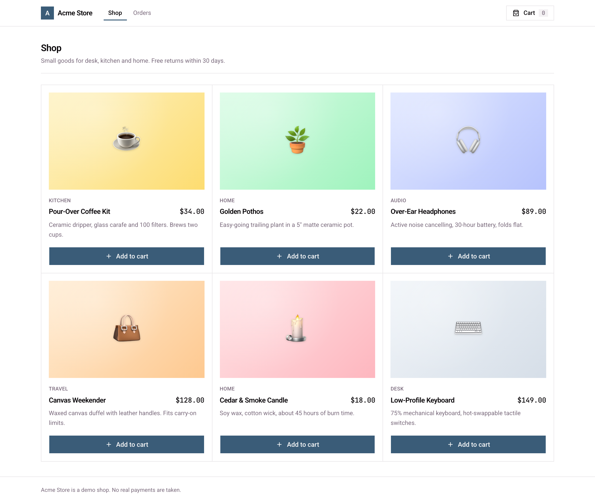

# Acme Store

A small online shop to try Rung on: a FastAPI backend with SQLite and a Next.js frontend. Browse
products, add them to a cart, apply a coupon, check out with a fake card and see your orders.



The app has a few deliberate bugs, the kind coding agents write, for Rung to find. Spoilers are in
[SOLUTIONS.md](SOLUTIONS.md).

## Run it

You need [uv](https://docs.astral.sh/uv/) and Node 20 or newer.

```bash
cd examples/acme-store
make dev            # or ./dev.sh
```

Open http://localhost:3000. The API runs on http://127.0.0.1:8000 and the web app proxies `/api/*`
to it, so the browser sees one origin.

| Variable | Default | What it does |
|---|---|---|
| `PORT` | `3000` | Web app port |
| `API_PORT` | `8000` | API port |
| `DATABASE_PATH` | `backend/acme.db` | SQLite file; deleted and re-seeded on every start |
| `PAYMENTS_LATENCY_MS` | `600` | How long the fake payment provider takes per charge |
| `PAYMENTS_FAIL_RATE` | `0` | Share of charges the provider declines, 0 to 1 |

Coupons: `WELCOME10` (10% off), `FRIENDS50` ($50 off), `BIGSPENDER` (20% off orders over $200).
Any 16-digit card number works.

Tests and build:

```bash
cd backend && uv run pytest -q
cd ../frontend && npm run typecheck
npm run build
```

## Try Rung on it

```bash
cd examples/acme-store
uvx --from rung-cli rung init
uvx --from rung-cli rung map        # draft and approve the feature map
uvx --from rung-cli rung draft runtime --require .png
```

`rung kit` shows the kit: each check, how it stands, and the next command to run.

## Layout

```
backend/
  app/main.py         app factory and routes
  app/routes/         products, cart, checkout and orders
  app/pricing.py      line totals, coupons, order total
  app/payments.py     fake card payment provider
  app/db.py, seed.py  SQLite schema and the starting catalog
  tests/              pytest
frontend/
  app/                Next.js pages: shop, cart, checkout, orders
  components/         UI, including shadcn-style primitives in components/ui
dev.sh                starts both
```
